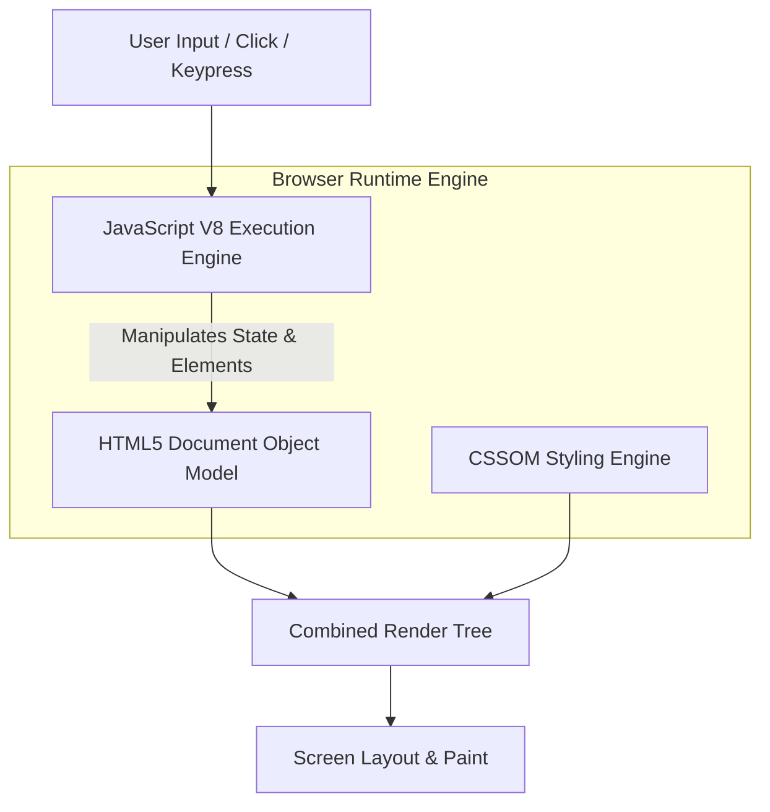

# 🌐 Full-Stack Development Suite — Interactive JavaScript & DOM Application Suite

<p align="center">
  
</p>

<p align="center">
  <b>27 Standalone Interactive Web Modules: Real-Time Digital Clocks, Dynamic Calculators, Institutional Portals, and Advanced DOM Handlers.</b>
</p>

<p align="center">
  
  
  
  
</p>

<p align="center">
  
</p>

---

<a id="table-of-contents"></a>
## 📌 Table of Contents

- [📖 Executive Summary & Overview](#executive-summary--overview)
- [🎯 Key Features & Capabilities](#features)
- [🏗️ System Architecture & Pipeline](#system-architecture--pipeline)
- [🛠️ Tech Stack Breakdown](#tech-stack-breakdown)
- [🔬 Modules Showcase](#modules-showcase)
- [⚙️ Reproducible Quickstart & Setup](#setup)
- [📁 Project Directory Layout](#project-layout)
- [🧪 Testing & Validation](#testing--validation)
- [🔮 Future Improvements & Roadmap](#future-improvements--roadmap)
- [🤝 Contributing Guidelines](#contributing-guidelines)
- [👨‍💻 Author & Contributions](#author--contributions)

---

<a id="executive-summary--overview"></a>
## 📖 Executive Summary & Overview

Modern web software engineering demands deep fluency with browser runtimes: semantic HTML document structures, fluid responsive styling, and vanilla JavaScript DOM manipulation. Relying exclusively on frameworks without understanding underlying browser APIs produces fragile, unmaintainable frontend code.

The **Full-Stack Development Suite** (`FSD_AMARAIAH`) contains **27 standalone interactive web applications and lab modules** created by **Amaraiah C** during Full Stack Web Development coursework at Alliance University. The suite covers core JavaScript logic, DOM manipulation, responsive form validation, real-time timers, calculators, and responsive institutional layouts.

---

<a id="key-features--capabilities"></a>
## 🎯 Key Features & Capabilities

### ⏰ 1. Real-Time Digital Clock (`digital_clock using js.html`)
- Continuous interval timer (`setInterval`) updating HH:MM:SS with 12-hour AM/PM meridian indicators.

### 🔢 2. Dynamic Calculator (`calculator.html`)
- Interactive keypad supporting decimal operations, clear triggers, and error boundary trapping.

### 🏛️ 3. Institutional Portal (`alliance.html`)
- Styled student portal authentication interface with client-side credential verification.

---

<a id="system-architecture--pipeline"></a>
## 🏗️ System Architecture & Pipeline



---

<a id="tech-stack-breakdown"></a>
## 🛠️ Tech Stack Breakdown

| Technology | Usage | Capabilities Demonstrated |
| :--- | :--- | :--- |
| **HTML5** | Markup Structure | Semantic containers, fieldsets, forms, tables |
| **CSS3** | Layout & Styling | Flexbox grids, absolute positioning, hover transitions |
| **JavaScript (ES6+)** | Frontend Logic | Event listeners, timers, loops, conditional branching |
| **Browser APIs** | DOM & BOM | `document.getElementById`, `window.setInterval`, `Date()` API |

---

<a id="modules-showcase"></a>
## 🔬 Modules Showcase

| Module | Core Functionality | Primary Tech |
| :--- | :--- | :--- |
| `digital_clock using js.html` | Real-time ticking 12-hour clock with AM/PM indicator | JS `Date()`, `setInterval` |
| `calculator.html` | Interactive arithmetic calculator with dynamic display | JS DOM event dispatch |
| `alliance.html` | Alliance University styled login interface | CSS Flexbox, HTML Forms |
| `facebook_login_form.html` | Social authentication clone layout | CSS Responsive Design |
| `DOM IN JS.html` | Dynamic node insertion, removal, and styling | Direct DOM manipulation |

---

<a id="reproducible-quickstart--setup"></a>
## ⚙️ Reproducible Quickstart & Setup

### Prerequisites
- Modern web browser (Chrome, Edge, Firefox)

```bash
# 1. Clone repository
git clone https://github.com/Amaraiah11/FSD_AMARAIAH.git
cd FSD_AMARAIAH

# 2. Launch any module in your browser
start "digital_clock using js.html"
start "calculator.html"
start "alliance.html"
```

---

<a id="project-directory-layout"></a>
## 📁 Project Directory Layout

```text
FSD_AMARAIAH/
├── alliance.html                  # Institutional portal login layout
├── calculator.html                # Interactive JavaScript calculator application
├── digital_clock using js.html    # Real-time ticking digital clock
├── DOM IN JS.html                 # Document Object Model manipulation sandbox
├── facebook_login_form.html       # Social login interface clone
├── Basics and variables of js.html# JavaScript syntax and variable scoping
├── conditions_in_js.html          # Decision branching logic
├── Functions in js.html           # Function declarations, expressions & callbacks
├── forms.html                     # Form inputs and attributes
└── ... (27 web modules in total)
```

---

<a id="testing--validation"></a>
## 🧪 Testing & Validation

- **Cross-Browser Verification:** Verified layout integrity and JS event execution across Chrome, Edge, and Firefox.
- **Console Log Hygiene:** Verified zero unhandled JavaScript errors in the browser developer tools console.

---

<a id="future-improvements--roadmap"></a>
## 🔮 Future Improvements & Roadmap

- [ ] Refactor modules into a unified single-page React or Vite application.
- [ ] Add LocalStorage persistence to the calculator and digital clock apps.

---

<a id="author--contributions"></a>
## 👨‍💻 Author & Contributions

This project is developed and maintained with rigorous engineering standards by **Amaraiah C**, Software Developer and Applied Data Analytics Practitioner studying Bachelor of Computer Applications (BCA) at Alliance University, Bangalore.

- 🌐 **GitHub Profile:** [@Amaraiah11](https://github.com/Amaraiah11)
- 💼 **LinkedIn Profile:** [Connect on LinkedIn](https://www.linkedin.com/in/amaraiah-c/)
- 📧 **Institutional Email:** `camaraiahBCA24@ced.alliance.edu.in`

### 🤝 Contributing Guidelines
Contributions, bug reports, and architectural discussions are welcome!
1. **Fork** the repository: `https://github.com/Amaraiah11/FSD_AMARAIAH`
2. **Create a Feature Branch:**
   ```bash
   git checkout -b feature/your-feature-name
   ```
3. **Commit Your Enhancements:**
   ```bash
   git commit -m "feat: enhance feature logic"
   ```
4. **Push to Your Branch:**
   ```bash
   git push origin feature/your-feature-name
   ```
5. **Open a Pull Request** against the `Amaraiah-C` branch.

---

<p align="center">
  <b>⭐ If this codebase or documentation assisted your engineering workflows, please star the repository! ⭐</b>
</p>

<p align="center">
  
</p>
