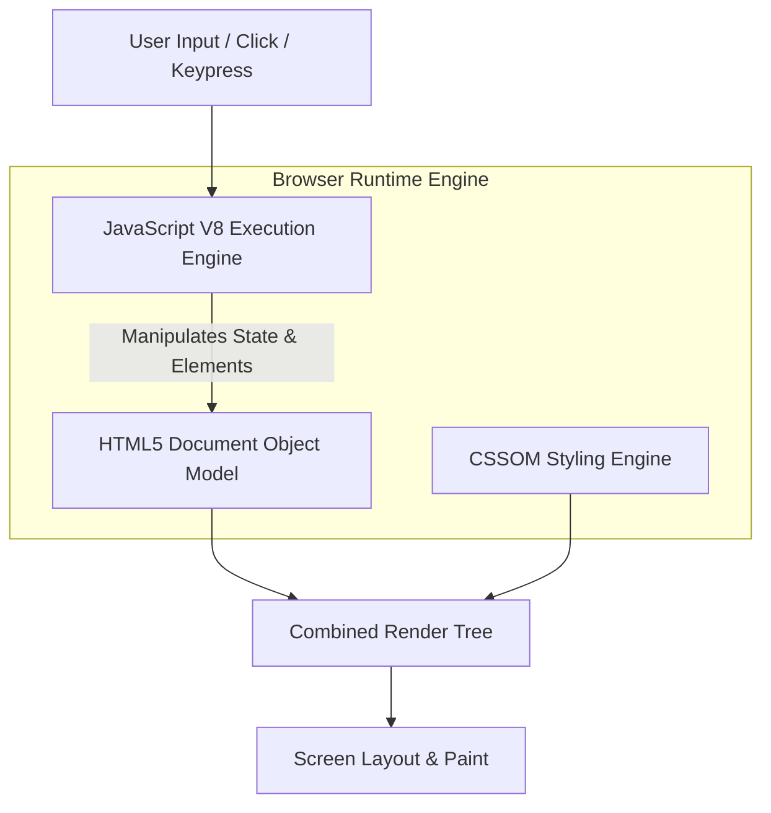

<p align="center">
  
</p>

<p align="center">
  
  
  
  
</p>

<a id="overview"></a>
## 📖 Executive Summary & Overview

Modern web applications demand robust frontend foundations: semantic HTML structures, fluid responsive styling, and performant vanilla JavaScript DOM event listeners. Relying entirely on monolithic frameworks without understanding underlying browser APIs can result in fragile, bloated code.

The **Full-Stack Development Suite** (`FSD_AMARAIAH`) contains **27 standalone interactive web applications and lab modules** created during Full Stack Web Development coursework at Alliance University. The collection covers foundational JavaScript logic, event dispatchers, responsive form validations, digital clock intervals, custom calculator logic, and institutional portal prototypes.

<a id="toc"></a>
## 📑 Table of Contents

- [📖 Executive Summary & Overview](#overview)
- [🎯 Key Features & Capabilities](#features)
- [🏗️ System Architecture & Pipeline](#architecture)
- [🛠️ Tech Stack Breakdown](#tech-stack)
- [⚙️ Reproducible Quickstart & Setup](#setup)
- [📁 Project Directory Layout](#project-layout)
- [👨‍💻 Author & Contributions](#author)

<a id="features"></a>
## 🎯 Key Features & Capabilities

- **Dynamic Interactive Calculator (`calculator.html`):** Custom keypad layout supporting floating-point arithmetic, clearing, and error trapping.
- **Real-Time Digital Clock (`digital_clock using js.html`):** Continuous interval timer (`setInterval`) updating HH:MM:SS with AM/PM meridian formatting.
- **Institutional Login Portal (`alliance.html`):** Styled authentication view incorporating input constraints and credential validation.
- **DOM & Event Handling Demonstrations (`DOM IN JS.html`):** Direct DOM node traversal, element creation, class toggles, and event propagation.
- **Social Media Layout Prototypes (`facebook_login_form.html`):** Responsive authentication form layout utilizing CSS Flexbox.

<a id="architecture"></a>
## 🏗️ System Architecture & Pipeline



<a id="tech-stack"></a>
## 🛠️ Tech Stack Breakdown

| Technology | Usage | Capabilities Demonstrated |
| :--- | :--- | :--- |
| **HTML5** | Markup Structure | Semantic containers, fieldsets, forms, audio/video elements |
| **CSS3** | Layout & Styling | Flexbox grids, absolute positioning, hover transitions, media queries |
| **JavaScript (ES6+)** | Frontend Logic | Event listeners, timers, loops, conditional branching, closures |
| **Browser APIs** | DOM & BOM | `document.getElementById`, `window.setInterval`, `Date()` API |

<a id="setup"></a>
## ⚙️ Reproducible Quickstart & Setup

### Prerequisites
- Modern web browser (Google Chrome, Microsoft Edge, Mozilla Firefox)

```bash
# 1. Clone repository
git clone https://github.com/Amaraiah11/FSD_AMARAIAH.git
cd FSD_AMARAIAH

# 2. Launch any module directly in your browser
# Example: Digital Clock
start "digital_clock using js.html"

# Example: Interactive Calculator
start "calculator.html"

# Example: Institutional Portal
start "alliance.html"
```

<a id="project-layout"></a>
## 📁 Project Directory Layout

```text
FSD_AMARAIAH/
├── alliance.html                  # Institutional portal login layout
├── calculator.html                # Interactive JavaScript calculator application
├── digital_clock using js.html    # Real-time ticking digital clock
├── DOM IN JS.html                 # Document Object Model manipulation sandbox
├── facebook_login_form.html       # Social login interface clone
├── Basics and variables of js.html# JavaScript syntax and variable scoping
├── conditions_in_js.html          # Decision branching logic
├── Functions in js.html           # Function declarations, expressions & callbacks
├── forms.html                     # Form inputs and attributes
└── ... (27 web modules in total)
```

<a id="author"></a>
## 👨‍💻 Author & Contributions

This project is developed and maintained with high technical rigour by **Amaraiah C**, Software Engineer and Data Analytics Practitioner studying Bachelor of Computer Applications (BCA) at Alliance University.

- 🌐 **GitHub:** [@Amaraiah11](https://github.com/Amaraiah11)
- 💼 **LinkedIn:** [Connect on LinkedIn](https://www.linkedin.com/in/amaraiah-c/)
- 📧 **Institutional Contact:** `camaraiahBCA24@ced.alliance.edu.in`

### 🤝 Contribution Guidelines
Contributions, bug reports, and architectural discussions are welcome!
1. **Fork** the repository: `https://github.com/Amaraiah11/FSD_AMARAIAH`
2. **Branch**: `git checkout -b feature/your-feature-name`
3. **Commit**: `git commit -m "feat: enhance feature logic"`
4. **Push**: `git push origin feature/your-feature-name`
5. **Open Pull Request** against the `Amaraiah-C` branch.

---

<p align="center">
  <b>⭐ If this codebase or documentation assisted your engineering workflows, please star the repository! ⭐</b>
</p>

<p align="center">
  
</p>
